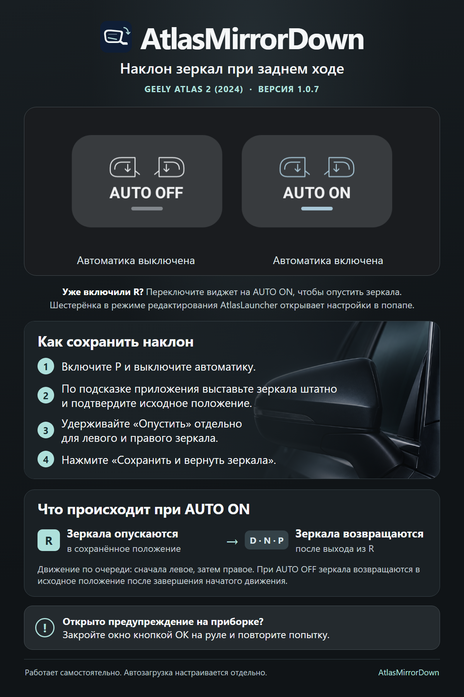

# AtlasMirrorDown

Автоматический наклон наружных зеркал при заднем ходе на Geely Atlas 2 (2024). После выхода из R зеркала возвращаются в исходное положение.

**[Скачать APK 1.0.8](https://github.com/SergeyVBro/atlas_mirror_down/releases/download/v1.0.8/AtlasMirrorDown-1.0.8.apk)** · [Релиз v1.0.8](https://github.com/SergeyVBro/atlas_mirror_down/releases/tag/v1.0.8) · [Все релизы](https://github.com/SergeyVBro/atlas_mirror_down/releases)

## Как пользоваться

1. Включите P и выключите автоматический наклон. Если приложение попросит подтвердить исходное положение, сначала выставьте зеркала штатной регулировкой.
2. Удерживайте «Опустить» отдельно для левого и правого зеркала. Затем нажмите «Сохранить и вернуть зеркала».
3. Добавьте виджет на рабочий стол. Кнопка AUTO ON / AUTO OFF переключает автоматический наклон. Если R уже включена, нажатие ON запускает наклон по сохранённой калибровке.

В AtlasLauncher попап настроек открывается по шестерёнке в режиме редактирования виджетов. Его также можно открыть по значку приложения.

Если окно предупреждения на приборке мешает выбору зеркала, подтвердите его кнопкой ОК на руле и повторите попытку.

